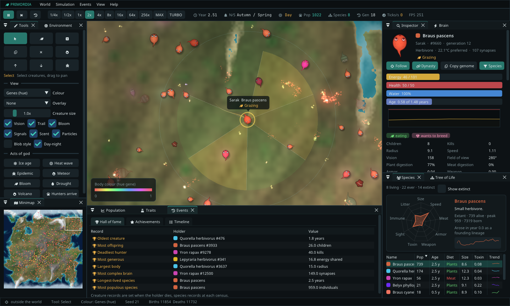

# Primordia

A native, multithreaded evolution simulator. Thousands of creatures with evolving bodies and recurrent
neural-network brains graze, hunt, flee, signal, share food, catch diseases, speciate and go extinct on a
procedurally generated planet with seasons, day and night, and climate. Nothing about behaviour is scripted.

Built with C++20, SDL3, OpenGL 3.3, Dear ImGui (docking) and ImPlot.



## Running

```bash
./install.sh        # build + add "Primordia" to your application menu
./run.sh            # build if needed, then launch
./run.sh --nvidia   # render on the discrete NVIDIA GPU (PRIME offload)
```

Command-line options (`./run.sh --help`):

| Option | Meaning |
| --- | --- |
| `--scenario N` | start from a scenario (0-10, in welcome-screen order) |
| `--seed N` | world seed |
| `--size N` | world width/height in units (default 4096) |
| `--population N` | initial creatures |
| `--threads N` | simulation threads (default: all) |
| `--load FILE` | open a saved world |
| `--headless --ticks N` | run without a window and print statistics |
| `--bench` | headless throughput benchmark |
| `--screenshot FILE --frames N` | render N frames offscreen and save a PNG |
| `--newick FILE` | headless: write the tree of life (Newick) when the run ends |

Saves, screenshots, time-lapse frames and exports (statistics CSV, species CSV, tree of life in Newick format
for tools like FigTree or iTOL) go to `~/Documents/Primordia/`. The world autosaves
every 10 minutes and on exit, and the welcome screen offers **Continue where you left off**. The world also
keeps a checkpoint for each of the last 8 simulated years in memory: **Simulation > Rewind to** (or the
rewind button on the toolbar) jumps back so you can branch history and try something different.

## Controls

| Input | Action |
| --- | --- |
| Space / `.` | pause / step one tick |
| `1`-`9`, `0` | speed from 1/4x to 256x, `0` = as fast as the CPU allows (TURBO on the toolbar goes further) |
| Mouse wheel | zoom at cursor |
| Right/middle drag, WASD | pan (left-drag on empty ground also pans) |
| Left click | select a creature, or use the active tool |
| `F` | follow the selected creature (Dynasty mode hands the camera to its offspring when it dies) |
| `C` / `O` | cycle colour mode / map overlay |
| `V` `G` `B` | vision cone / bloom / Primer-style blob art |
| Ctrl+C | copy the selected creature's genome |
| `[` / `]` | highlight the previous / next living species |
| `K` | cinematic mode: hide the interface and tour interesting creatures |
| Tab | hide the interface |
| F11 / F12 | record time-lapse / screenshot |
| F10, Alt+Enter | fullscreen |
| M | sound on/off (procedural wind, night crickets, chimes for new species; off by default) |
| Ctrl+N, Ctrl+S, Ctrl+O | new world, save, open |

## What evolves

**Body (23 genes):** size, speed, diet (plants to meat), armour, weapons, toxins, immunity, night vision,
vision range and field of view, colour and markings, thermal optimum, mutation rate and step size (evolvable
evolvability), parental investment, maturity, longevity, litter size, sexual vs. asexual reproduction, and
an internal clock, plus a preferred mate colour and choosiness that drive sexual selection.

**Brain:** a 16-neuron recurrent network. Senses: five eye sectors (plants, carcasses, creatures, relative
size, colour similarity as a kin cue, obstacles), energy, health, age, speed, water, temperature, grass
underfoot, pain, touch, sickness, daylight, an internal clock, sounds from neighbours, and pheromone smell
plus its gradient, and flocking cues (neighbours' average heading and crowding). Actions: thrust, turn, eat, attack, reproduce, glow a signal, share food, lay pheromone.
Mutation adds and prunes synapses, so brain complexity itself evolves against an energy cost.

**Open-ended extras (nothing assigns them a meaning):**
- *Voice channels.* Two call outputs (Call A / B) and matching ears that hear loudness and direction. What a call
  means, and how listeners react, has to evolve; alarm cries, food calls and local dialects are possible.
- *Lifetime learning.* A plasticity gene lets a brain rewire its hidden-to-output links toward whatever just paid off
  (reward-modulated Hebbian), at an energy cost. Mothers pass on part of what they learned.
- *Niche construction.* A "tend soil" output cultivates the ground, raising plant growth there for a while. Farmers,
  and thieves who graze other species' fields, can evolve.

## Discoveries

Events panel > **Discoveries** is a journal of behaviours the simulation produced on its own. A detector watches each
species and writes an entry when something clearly stands out: a call that is used in one context far more than
elsewhere ("Call A when hurt"), listeners that bolt or freeze when they hear it, farming and poaching, species that
learn, a lineage that changes fast, population crashes, cannibalism. Click an entry to fly there and highlight the
species. **Export journal** writes it as Markdown to `~/Documents/Primordia/`. `--headless` prints the journal at the end.

## Rules of the world

- Metabolism follows Kleiber's law (cost ~ mass^0.75); big bodies lose heat more slowly (Bergmann's rule).
- Big attackers shred small targets; small ones barely scratch giants.
- Toxic creatures poison whoever bites them or eats their carcass, so warning colours and mimicry can evolve.
- Diet is a trade-off: generalists digest both foods poorly.
- Contagious disease spreads by contact, mostly within a species, and leaves temporary immunity (SIR dynamics).
  Pathogen strains evolve too: aggressive strains spread faster but burn out sooner and harm more.
- At night sight shrinks unless a creature has night vision; glowing (signalling) creatures stay visible.
- Seasons are opposite in each hemisphere; poles freeze in winter and plants die back.
- A lineage that drifts far enough genetically becomes a new species with a generated Latin name.
- Creatures dehydrate (faster in heat); they drink at shores or get water from lush grass.
- Optional glacial cycles swing the climate; cold periods lower the sea and open land bridges.
- Pack hunting adds damage per extra attacker; prey in crowds are harder to single out.
- Hawk-dove food contests (as in Primer's game-theory video): doves share a patch, hawks bully doves, two
  hawks fight. The Game theory chart tracks the hawk share over time.
- Camouflage: a colour matching the ground (green grass, tan earth) is spotted from closer, especially when still.
- Close sister species occasionally hybridize when they meet.
- Mate choice: creatures prefer partners of a particular colour, which can drive runaway sexual selection.
- If hunters die out, a new hunting lineage immigrates half a year later (can be switched off).

## Scenarios

Primordial Soup, Natural Selection 101, Predator & Prey, Warning Colours, Epidemic, Island Hopping, Ice Age,
Kin & Altruism, Cambrian Explosion, Single Origin, and Desert Pangaea. Pick one on the welcome screen or under World > Scenarios.

## Getting around

Help > Guided tour walks through every panel. Right-click a creature for a context menu, double-click to
follow it. Preferences can pause the simulation automatically when a new species appears, an established one
goes extinct, or an achievement unlocks. The Genome Lab copies genomes to the clipboard as text, so creatures
can be shared between worlds.

## Primer Lab

View > Primer Lab opens a small, separate arena recreating the classic speed / size / sense experiment: blobs
leave the edge each day, one food means survival and two means a child, every step costs
size^3 x speed^2 + sense, and blobs 20% bigger can eat smaller ones. Histograms of each trait update daily.

## Panels

Inspector (live portrait, personal name, current activity, ancestry, family, what mutated at birth,
energy/health/water history, genome vs. population average), Brain (what each eye sees, plus live network activity), Population (population with catastrophe
markers, Lotka-Volterra phase portrait, species stack plot, diversity, environment, minds, behaviour, epidemic
SIR curves, causes of death), Traits (Primer-style trait-distribution heatmaps over time, morphospace scatter,
which senses brains rely on), Species (sortable table with trend sparklines, and a field-guide card with a trait radar; double-click a name
to rename it; highlighting a species draws its migration path on the map), Tree of Life
(zoomable phylogeny with population-weighted branches), Events and Hall of Fame, Environment (live
parameters), Tools (feed, spawn, clone, smite, meteor, terraform, infect), Genome Lab (design your own
creature) Minimap, and Preferences (interface scale, fullscreen, v-sync).

Overlays include temperature, fertility, plant biomass, pheromone trails, rainfall and species territories,
each with a legend. Press `K` for
a cinematic tour that hides the interface and cuts between creatures that are hunting, sharing or falling ill.

## Building by hand

Requires CMake 3.20+, a C++20 compiler, SDL3, libepoxy and OpenGL 3.3. Dear ImGui and ImPlot are vendored in
`third_party/`.

```bash
cmake -S . -B build -DCMAKE_BUILD_TYPE=Release
cmake --build build -j
./build/primordia
```

`-DPRIMORDIA_NATIVE=OFF` builds without `-march=native` for a portable binary.

## Layout

```
src/core    maths, PCG random numbers, simplex noise, fork-join thread pool
src/sim     genome and brain, world simulation, species tracking, scenarios, save/load
src/render  OpenGL renderer: terrain shader, instanced SDF creatures, particles, bloom
src/ui      Dear ImGui panels and theme
src/app     window, input, camera, scheduling, headless mode
```
